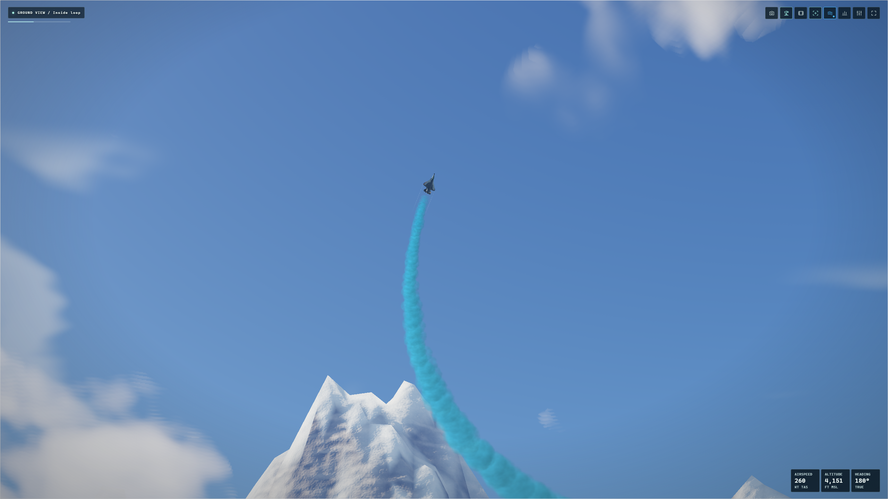

# Stratos Flight Simulator

Stratos is a single-file WebGPU flight simulator with a procedural alpine coast, clouds, live cockpit instruments, and a ground camera with movement and jet-following controls for watching aerobatics.

## Fly

[Play Stratos in your browser](https://sanketshahane05.github.io/fighterJet/).

Download [index.html](index.html) and open it in a WebGPU-enabled browser. Chrome 157 was tested with hardware acceleration. The simulator requires no installation, build, external assets, or network connection.

For a ground-level airshow, choose **Airshow Practice** and click **Start Flight**. Smoke and spectator following start on. Press **3** to watch a loop. The **Following jet** button anchors your viewpoint to the jet's horizontal movement. Toggle it for a fixed lookout, use the arrow keys to move, and press **Home** or **Recenter** to choose a clear position near the jet.

| Control | Action |
| --- | --- |
| Mouse, W/S, A/D | Pitch and roll, throttle, rudder |
| Shift, Space, G | Afterburner, air brake, landing gear |
| C, F, T | Cycle cameras, toggle orbit camera, toggle ground camera |
| Arrow keys | Move the spectator forward, backward, left, or right |
| PageUp, PageDown | Raise or lower the spectator above the terrain |
| L | Toggle following the jet and a fixed lookout |
| Scroll, Home, Shift+T | Zoom from ground view, recenter near the jet |
| B, V | Toggle smoke, cycle its color |
| 1, 2, 3, 4 | Left roll, right roll, inside loop, Immelmann |
| X, R, P | Cancel a maneuver, restart, pause |
| H, I, M | Toggle HUD, performance overlay, sound |
| Esc | Release the mouse |

## Verification

[Watch the 60-second fly-through](verification/fly-through.mp4). See the [performance report](verification/performance.md), [raw benchmark](verification/benchmark.json), and [independent visual review](verification/visual-review.md) for the hardware and sampling details.

## Credits

Created by Sanket Shahane with [OpenAI Codex](https://github.com/codex).

Released under the [MIT License](LICENSE).
