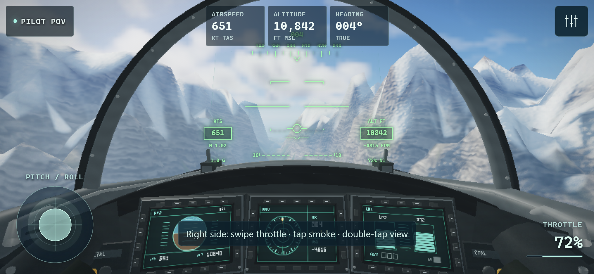
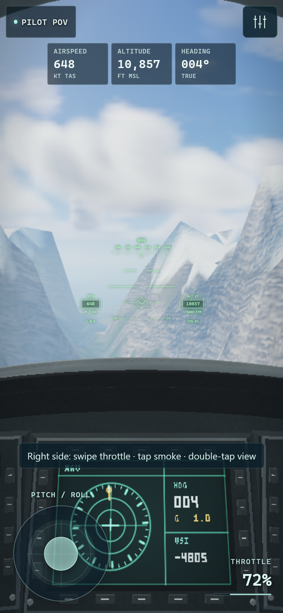

# Mobile gesture controls

The mobile flight screen now has a joystick, a small throttle/height readout, and one flight-menu button. The rows of action, rudder, boost, brake, gear, and spectator buttons have been removed from this screen. Secondary actions remain in the paused flight menu. Desktop controls remain available.

Verified build: 221,078 bytes; SHA-256 `9726ae9aa9c58866d651da5a42b9944bf68ee0c03a255e187ff49eeeae76409f`.

| Right-side gesture | Flight | Ground spectator |
| --- | --- | --- |
| Vertical swipe | Set throttle | Set lookout height |
| Tap | Toggle smoke | Toggle smoke |
| Double-tap | Change camera | Change camera |
| Hold still for 600 ms | Boost until release | No boost |
| Horizontal swipe | Guided left/right roll, when flight conditions permit | No roll |
| Two-finger pinch | No flight command | Zoom toward/away from the aircraft |

The joystick continues to steer pitch and roll, or move the ground lookout. A finger on the joystick and another on the gesture area work independently. The menu contains colors, guided loops and other maneuvers, landing gear, an air-brake toggle, sound, HUD, graphics, multiplayer, Follow, and Recenter. Choosing a flight action resumes the simulation; toggle options keep the menu open. Opening multiplayer from the menu gives its panel ownership of the local pause, so closing the room panel resumes flight.

## Verification

Tests use actual Chrome DevTools touch events, including concurrent fingers, in hardware-accelerated Chrome 157 on the available RTX 4050 Laptop GPU. These are mobile browser-emulation checks rather than physical-handset tests.

- The joystick still changes pitch and bank and centers after release.
- Vertical swipes change throttle while another finger steers the joystick.
- A tap toggles smoke. A double-tap changes camera without executing the single-tap action.
- A stationary hold engages boost; release, cancellation, blur, or movement ends it.
- A horizontal swipe starts the correct roll without changing throttle. The menu cancels a maneuver.
- Pausing clears pending taps and held controls.
- Menu buttons remain reachable when disclosures expand and the sheet scrolls. Secondary actions and multiplayer open from the menu.
- Airshow Practice supports joystick movement, height swipes, and pinch zoom. A pinch is consumed until both fingers lift, preventing leftover taps, rolls, or height drags.
- Flight screens at 844 × 390, 390 × 844, 360 × 640, and 568 × 320 CSS pixels have exactly one visible button; joystick, menu, and gesture area stay within the viewport.
- The desktop overlay remains hidden and keyboard throttle controls work.
- No uncaught JavaScript exceptions occurred in the final checks.

The temporary gesture hint disappears after startup; a full guide stays in the menu. Camera transitions reset held inputs, so lift and retouch the joystick after changing view.

## Limits

WebGPU availability, physical-phone performance, and multiplayer networking have the same limits recorded in the [earlier mobile report](mobile.md) and [multiplayer report](multiplayer.md). Android/iPhone hardware testing and sustained mobile frame rate, temperature, and battery usage remain unverified. The earlier 60-second desktop benchmark does not measure this build.
