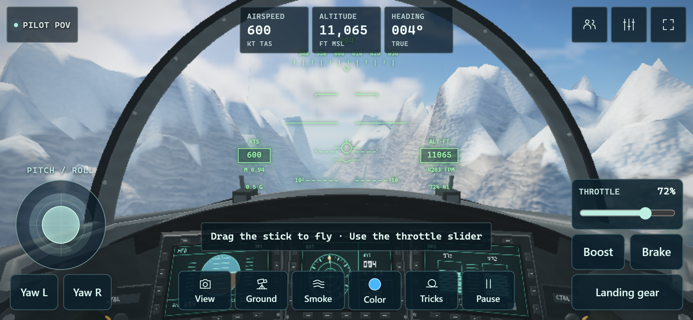
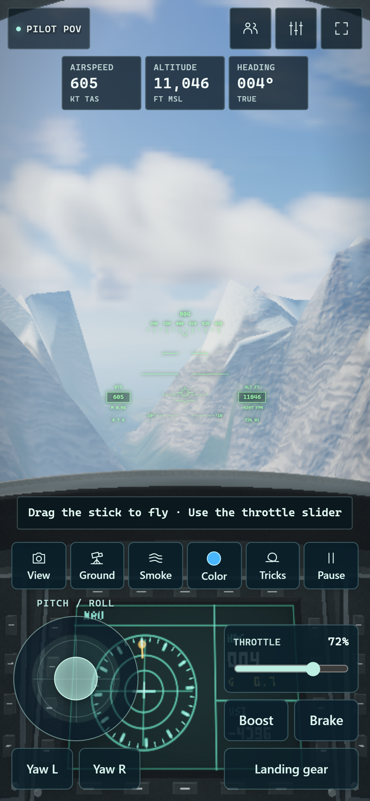

# Mobile controls and verification

The single-file build adds a touch joystick, throttle slider, rudder, afterburner, air brake, landing gear, smoke/color controls, camera selection, guided aerobatics, and spectator movement, height, and zoom. Touch menus also expose pause, sound, HUD, and multiplayer controls. Mouse and keyboard controls remain available.

Verified build: 219,143 bytes; SHA-256 `6d5d97e2156e4e149d5112bbf320165717f491d41d4735e71a2a21da2d8c3d96`.

Touch mode is selected from the primary pointer's coarse input capability. `?controls=touch` can explicitly enable it. Mobile graphics default to Low. Render scale is capped at 1× DPR for Low, 1.25× for High, and 1.5× for Ultra, with corresponding pixel budgets of 750,000, 1,050,000, and 1,400,000. Aspect ratio is preserved. Desktop rendering retains native DPR.

## Browser verification

Checks use actual Chrome DevTools touch events, including simultaneous fingers, in an isolated Chrome 157 profile on the available RTX 4050 Laptop GPU. This is browser mobile emulation rather than physical handset testing. At an 844 × 390 CSS viewport and emulated 3× DPR, the default render target measured 844 × 390, rather than 2532 × 1170.

- Stick motion changes the flight model's pitch and bank, and releasing it centers the controls.
- A second finger adjusts throttle while the first continues steering.
- Holding afterburner engages thrust; release, pointer cancellation, blur, and pause clear held inputs.
- Touch buttons switch cameras, toggle smoke, change color, start and cancel aerobatics, and control the ground spectator.
- Flight controls fit portrait and landscape phone layouts, with tappable control centers.
- Mobile multiplayer hosting, invite copying or selection, closing the room panel to resume, and leaving the room use the real public room service.
- The unsupported-WebGPU path leaves Start disabled and displays browser/device guidance.
- Desktop mode hides the touch overlay. No uncaught JavaScript exceptions occurred in the final checks.

The tested CSS viewports were 844 × 390, 390 × 844, 360 × 640, and 568 × 320, with emulated 3× device DPR. The short landscape aerobatics menu scrolls within the available height.

Ground view requires nearby land. If a free-flight location has no suitable viewpoint, the game explains the limit; Airshow Practice supplies a clear lookout.

## Compatibility limits

The renderer still requires WebGPU; this change does not add a WebGL fallback. Browser support alone does not verify a particular phone's GPU driver or rendering performance. Current Chrome on compatible Android devices and Safari on iOS 26 or later are the intended mobile browsers. WebKit documents the addition of [WebGPU in Safari 26](https://webkit.org/blog/17640/webkit-features-for-safari-26-2/). Chrome's official [WebGPU updates](https://developer.chrome.com/blog/new-in-webgpu-146) describe Android GPU support and its optional compatibility mode; this renderer requests a core WebGPU adapter.

Physical Android and iPhone testing, touch comfort on real hardware, sustained frame rate, temperature, and battery usage remain unverified. Multiplayer's [connectivity limits](multiplayer.md) still apply. A mobile host must keep the browser open; switching away pauses local flight, and closing the page ends its connections.

The earlier 60-second desktop benchmark does not measure this mobile build.
