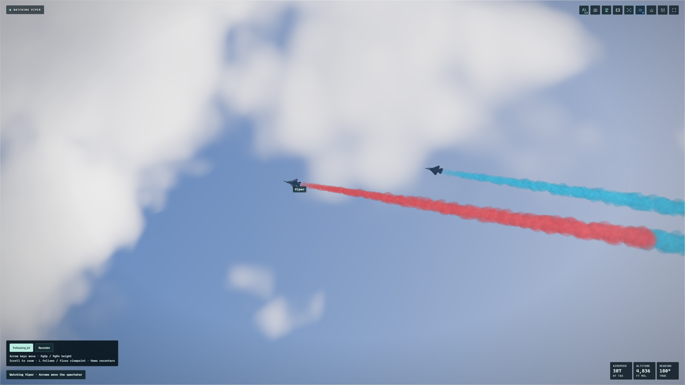

# Multiplayer verification

The multiplayer client was tested in separate hardware-accelerated Chrome 157 profiles on the available RTX 4050 Laptop GPU. Each profile rendered at 2560 × 1440. The clients used the public PeerJS room service for real signaling and native WebRTC data channels for flight packets.

## Passed checks

- A host created an eight-character room code, and another browser joined through the room controls.
- Both clients received changing remote aircraft positions and synchronized individual smoke colors during a right aileron roll.
- The ground spectator selected and followed the other pilot. The aircraft and smoke were visible in the rendered image.
- Four clients joined the same room and received all four participants. Guest state reached other guests through the host.
- A fifth client received a full-room message while the four existing pilots stayed connected.
- Departing pilots were removed from the roster. A guest rejoined the room successfully, and guests left multiplayer when the host closed the session.
- The room panel holds the local aircraft while it is open. Closing it returns control to the flight. Other players continue to receive flight state during that pause.

The transport sends snapshots at 20 Hz over an unordered channel and uses a separate reliable channel for room membership. Rendering interpolates quaternion orientation and position with a 110 ms presentation delay. Each remote aircraft has its own GPU uniform buffer and smoke ring. Peer messages are bounded and validated before entering simulation or rendering state.

## Connectivity limits

The tested clients ran on the same machine. Their selected candidate pair used direct host candidates, with approximately 1 ms measured round-trip time. Internet-separated players and other hardware remain unverified.

A relay-only test using the public TURN endpoints in PeerJS's documented default configuration timed out. Some restrictive networks may therefore prevent joining. The UI reports connection failures so players can try another network or room. Public signaling and NAT traversal services control their own availability.

Rooms end when the host leaves. This release supports cooperative flying and airshows.

The standard 60-second rendering benchmark in [performance.md](performance.md) belongs to an earlier single-player build.

The signaling adapter follows the [PeerJS connection protocol](https://github.com/peers/peerjs/blob/master/lib/negotiator.ts) and uses its [published ICE configuration](https://github.com/peers/peerjs/blob/master/lib/util.ts). The public service's sharing guidance is in [PeerServer Cloud](https://peerjs.com/server/cloud).
